<picture>
  <source media="(prefers-color-scheme: dark)" srcset="assets/banner-dark.svg">
  
</picture>

[LinkedIn](https://linkedin.com/in/siva-jyothi-pamarthy-14622547) · [Email](mailto:jyothipamarthy@gmail.com) · Stockholm, Sweden

### `$ ls ~/work --sort=proof`

| Repo | What it proves |
|---|---|
| **[devops-by-breaking](https://github.com/Jyothi0612/devops-by-breaking)** | I can debug, and I can design checks. 20 break-fix labs (disk full, 502s, CrashLoopBackOff), each one tested in CI on amd64 + arm64 to start broken and be fixable. |
| **[fika-stockholm](https://github.com/Jyothi0612/fika-stockholm)** | I can run many servers by hand. 11 RHEL 9 EC2 servers, Route 53 DNS on private IPs, a security group per server with only the ports it needs, every service a non-root system user under systemd. |
| **one shop, automated 3 ways** | I know *why* we automate. The same microservices shop (10 services, 11 from v2) deployed again and again, each version fixing what hurt in the last one. |

```text
shell v1  ──▶  shell v2  ──▶  ansible v1  ──▶  ansible v2   ──▶  terraform
copy-paste    common.sh      playbook per     reusable roles     infra as
scripts       + skip-if-done service          + vault secrets    code
```
[shell v1](https://github.com/Jyothi0612/shell-roboshop-v1) · [shell v2](https://github.com/Jyothi0612/shell-roboshop-v2) · [ansible v1](https://github.com/Jyothi0612/roboshop-ansible-v1) · [ansible v2](https://github.com/Jyothi0612/roboshop-ansible-v2) · [dynamic inventory](https://github.com/Jyothi0612/ansible-dynamic-inventory) · [terraform](https://github.com/Jyothi0612/learn-terraform)

### `$ tree ~/stack`

```text
~/stack
├── linux/      RHEL 9 · Rocky · Bash · systemd · nginx · cron · ssh        [built]
├── automate/   Ansible · Terraform                                         [built]
│               Git · GitLab · GitLab CI                                    [production]
├── cloud/      AWS EC2 · Route 53 · security groups                        [built]
│               Docker Compose                                              [production]
├── observe/    Sentry                                                      [production]
│               journalctl                                                  [built]
├── web/        TypeScript · Vue · REST APIs                                [production]
└── next/       Kubernetes · CI/CD pipelines · Prometheus                   [learning]

production = used at work · built = in my own repos · learning = in progress
```

### `$ git log --oneline career`

```text
2026      DevOps on AWS: Linux → shell → Ansible → Terraform, all built by hand first
2021–26   Frontend Developer · online gaming, 5 brands × 6 licensed markets
          live outage hotfix · pen-test XSS fix · Mercurial → Git/GitLab + CI · Docker Compose dev stack
2014–19   Software Engineer · web apps across frontend, backend and databases
```
